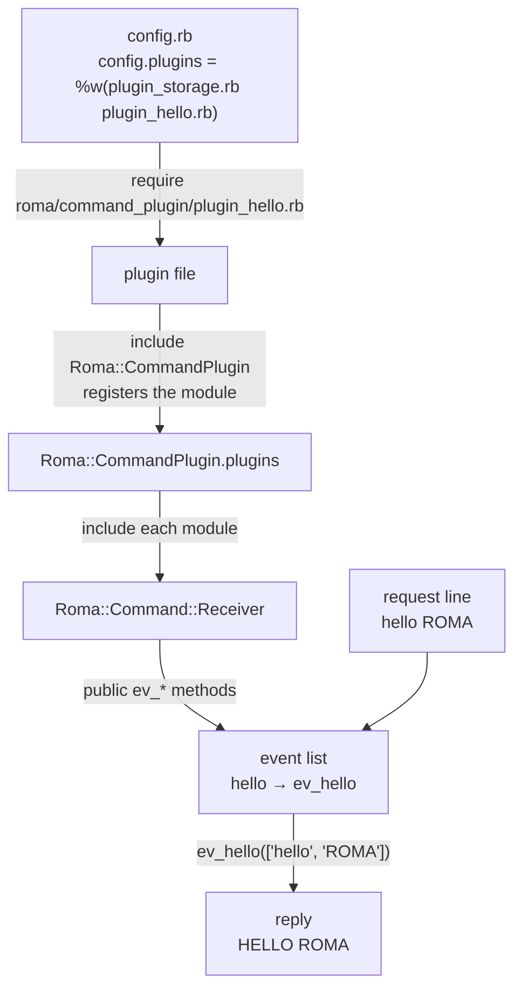

# Command plugins

This document is for developers who add commands to ROMA. It explains what a
command plugin is, how romad loads and runs it, and how to write, run and test
your first one.

- [Concepts](#concepts)
- [How it works](#how-it-works)
- [Getting started](#getting-started)
- [Writing commands](#writing-commands)
- [Things to know](#things-to-know)

## Concepts

### Commands

Clients talk to a node with a line-based text protocol, like memcached. A
request is a line of words separated by spaces and ending with `\r\n`. The
first word is the **command**, and the rest are its arguments. Some commands,
such as `set`, also send a data block after the line.

```
set foo 0 0 3\r\n
bar\r\n
```

The node replies with one or more lines, such as `STORED\r\n`.

Every command, even `get` and `set`, is a Ruby method of
`Roma::Command::Receiver` named `ev_` and the command name. The command `get`
runs `ev_get`.

### Command plugins

A **command plugin** is a Ruby module that defines such methods. romad adds the
modules you choose to `Roma::Command::Receiver`, so their methods become
commands.

ROMA's own commands for data are plugins too. They are in
[lib/roma/command_plugin/](../lib/roma/command_plugin/):

| File | Module | Commands |
| --- | --- | --- |
| `plugin_storage.rb` | `PluginStorage` | `get`, `set`, `delete`, `incr` and the other memcached commands |
| `plugin_alist.rb` | `PluginAlist` | `alist_*`: a list in a value |
| `plugin_map.rb` | `PluginMap` | `map_*`: a hash in a value |
| `plugin_mapcount.rb` | `PluginMapcount` | `mapcount_*`: counters in a value |
| `plugin_gui.rb` | `PluginGui` | commands for the GUI tools |
| `plugin_debug.rb` | `PluginDebug` | `eval` and other commands for debugging |
| `plugin_test.rb` | `PluginTest` | `echo`, a minimal sample |

`plugin_storage.rb` is the only plugin romad loads by default. Keep it when you
choose other plugins, or the node has no `get` and `set`.

## How it works



### Loading

When romad starts, it does these steps in `Romad#initialize_plugin`
([lib/roma/romad.rb](../lib/roma/romad.rb)):

1. For each file name in `config.plugins`, it requires
   `roma/command_plugin/<file>` from `$LOAD_PATH`. If no such file is there, it
   requires `roma/plugin/<file>` instead.
2. Each plugin module includes `Roma::CommandPlugin`. Its `included` hook adds
   the module to `Roma::CommandPlugin.plugins`.
3. romad includes every module in that list into `Roma::Command::Receiver`.

A plugin file is just a Ruby file. It can be anywhere in `$LOAD_PATH`, as long
as it is in a `roma/command_plugin/` directory.

### Dispatching

`Roma::Event::Handler`, the superclass of `Roma::Command::Receiver`, keeps an
**event list**: a hash from command names to method names. It is made from the
public methods whose names start with `ev_`, by removing the `ev_`.

For each request line, the handler splits the line by spaces, makes the first
word lowercase and looks it up in the event list. If it is found, it calls the
method with the words as an array. The request `hello ROMA` calls
`ev_hello(['hello', 'ROMA'])`. If it is not found, the client gets
`ERROR: 'hello' is not roma command.`

### The context of a command

A command method runs as an instance method of `Roma::Command::Receiver`, one
object for each client connection. So it can use what the receiver has:

| Name | What it is |
| --- | --- |
| `send_data(str)` | Sends `str` to the client. Each reply line ends with `\r\n`. |
| `read_bytes(size)` | Reads `size` bytes that the client sent after the line, such as a data block. |
| `@storages` | The storages by hash name. The default hash name is `@default_hash_name`, `roma`. |
| `@routing_table` | The routing table: `get_vnode_id(digest)`, `search_nodes(vnode)`, `nodes` and so on. See [Routing](routing.md). |
| `@stats` | `Roma::Stats`: the node ID (`my_node_id`), counters and settings. |
| `@log` | The logger. |
| `send_cmd(node_id, line)` | Sends a command to another node and returns the first line of its reply. |
| `broadcast_cmd(line)` | Sends a command to every other node and returns the replies by node ID. |
| `chg_time_expt(expire_time)` | Turns a memcached expire time into a Unix time. |

### Startup protection

While a node starts, it takes only the system commands: the commands for
routing, joining and the cluster (`Roma::Command::RoutingCommandReceiver`,
`BackgroundCommandReceiver` and `SystemCommandReceiver`). The others, including
every plugin command, are not in the event list yet, and clients get the
`not roma command` error for them.

The node checks every 10 seconds whether all the nodes in its routing table are
up. When they are, it logs `all nodes started` and adds all the commands to the
event list. These also add them:

- the `forcedly_start` command,
- starting romad with `--join`,
- starting romad with `--disable-command-protection`.

## Getting started

This section makes a plugin `PluginHello` with three commands, runs it on a node
and tests it. It needs ROMA installed or checked out.

| Command | What it does |
| --- | --- |
| `hello [<name>]` | Replies `HELLO <name>`, or `HELLO world` without a name. |
| `strlen <key>` | Replies the length of the value of the key. |
| `upcase <key>` | Makes the value of the key uppercase. |

### 1. Write the plugin

Make a directory for your plugin, with the file in `lib/roma/command_plugin/`:

```
hello/
├── config.rb
├── lib/
│   └── roma/
│       └── command_plugin/
│           └── plugin_hello.rb
└── test_plugin_hello.rb
```

`test_plugin_hello.rb` comes in [step 5](#5-test-the-plugin).

`lib/roma/command_plugin/plugin_hello.rb`:

```ruby
require 'roma/command/definition'

module Roma
  module CommandPlugin
    module PluginHello
      include Roma::CommandPlugin
      include Roma::Command::Definition

      # hello [<name>]\r\n
      #
      # HELLO <name>\r\n
      def ev_hello(s)
        name = s[1] || 'world'
        send_data("HELLO #{name}\r\n")
      end

      # strlen <key> [forward]\r\n
      #
      # (<length>|NOT_FOUND|SERVER_ERROR <error message>)\r\n
      def_read_command_with_key :strlen do |ctx|
        if ctx.stored
          send_data("#{ctx.stored.value.bytesize}\r\n")
        else
          send_data("NOT_FOUND\r\n")
        end
      end

      # upcase <key> [forward]\r\n
      #
      # (STORED|NOT_STORED|NOT_FOUND|SERVER_ERROR <error message>)\r\n
      def_write_command_with_key :upcase do |ctx|
        next send_data("NOT_FOUND\r\n") unless ctx.stored

        # [flags, expire time, value, kind of counter(:write/:delete), result message]
        [0, ctx.stored.expire_time, ctx.stored.value.upcase, :write, 'STORED']
      end
    end
  end
end
```

- `include Roma::CommandPlugin` makes the module a plugin.
- `hello` is a plain method. It gets the words of the request line in `s`.
- `strlen` and `upcase` take a key. `Roma::Command::Definition` gives the class
  macros `def_read_command_with_key` and `def_write_command_with_key`. They find
  the node of the key, read the stored data and pass it to the block. See
  [Writing commands](#writing-commands).

### 2. Choose the plugin in config.rb

`config.rb`:

```ruby
Roma.configure do |config|
  config.plugins = %w(plugin_storage.rb plugin_hello.rb)
end
```

### 3. Start a node

Make a routing table for one node with no replicas, and start romad. `RUBYLIB`
adds your `lib` directory to `$LOAD_PATH`, so that romad finds
`roma/command_plugin/plugin_hello.rb`.

```sh
cd hello
roma route create localhost_11211 -r 1
RUBYLIB=./lib roma server localhost -p 11211 -d --config config.rb
```

The log, `localhost_11211.log`, shows that the plugin is loaded:

```
INFO -- : roma/command_plugin/plugin_hello.rb loaded
INFO -- : Roma::CommandPlugin::PluginHello included
```

Wait for `all nodes started` in the log, up to 10 seconds. Until then, the node
doesn't take plugin commands (see [Startup protection](#startup-protection)).

### 4. Try the commands

Connect with telnet or nc:

```
$ telnet localhost 11211
hello
HELLO world
hello ROMA
HELLO ROMA
strlen foo
NOT_FOUND
set foo 0 0 5
world
STORED
strlen foo
5
upcase foo
STORED
get foo
VALUE foo 0 5
WORLD
END
quit
```

To stop the node, send `balse` and then `yes`.

### 5. Test the plugin

The ROMA repository has a test harness,
[test/plugin_test_harness.rb](../test/plugin_test_harness.rb). It runs plugin
commands in the test process, without romad or sockets: it stores data in a
hash storage, and records replication instead of sending it to other nodes.
`request(line, data)` runs a command and returns what it replied.

```ruby
require 'test/unit'
require 'plugin_test_harness'
require 'roma/command_plugin/plugin_storage'
require 'roma/command_plugin/plugin_hello'

class PluginHelloTest < Test::Unit::TestCase
  def setup
    @conn = PluginTestHarness.for(Roma::CommandPlugin::PluginStorage, Roma::CommandPlugin::PluginHello).new
  end

  def test_hello
    assert_equal "HELLO world\r\n", @conn.request('hello')
    assert_equal "HELLO ROMA\r\n", @conn.request('hello ROMA')
  end

  def test_strlen
    assert_equal "NOT_FOUND\r\n", @conn.request('strlen key1')
    @conn.request('set key1 0 0 5', 'value')
    assert_equal "5\r\n", @conn.request('strlen key1')
  end

  def test_upcase
    @conn.request('set key1 0 0 5', 'value')
    assert_equal "STORED\r\n", @conn.request('upcase key1')
    assert_equal "VALUE key1 0 5\r\nVALUE\r\nEND\r\n", @conn.request('get key1')
    # The new value goes to the other nodes, too.
    assert_equal 'VALUE', @conn.redundant_calls.last[:value]
  end
end
```

Run it from a checkout of the ROMA repository next to `hello/`, with the harness
and your plugin in the load path:

```sh
bundle exec ruby -Ilib -Itest -I../hello/lib ../hello/test_plugin_hello.rb
```

The harness is a part of ROMA's tests, not a public API. The plugins' tests in
[test/roma/command_plugin/](../test/roma/command_plugin/) show more ways to use
it, such as forwarding between two nodes.

## Writing commands

There are two ways to write a command: a plain `ev_` method, or a class macro
of `Roma::Command::Definition`.

### Plain methods

A public method named `ev_<command>` is a command. It gets the words of the
request line, and replies with `send_data`.

```ruby
def ev_hello(s)
  send_data("HELLO #{s[1] || 'world'}\r\n")
end
```

A plain method does everything itself: checking the arguments, reading a data
block with `read_bytes`, finding the node of a key, forwarding and replicating.
Use it for commands that don't take a key, such as commands about the node.
`ev_get` in [plugin_storage.rb](../lib/roma/command_plugin/plugin_storage.rb)
shows what a command with a key does by hand.

### Class macros

To use the macros, include `Roma::Command::Definition` in the plugin. Each macro
defines `ev_<command>` from a block.

| Macro | Use it for |
| --- | --- |
| `def_read_command_with_key(cmd, forward = :one_line)` | a command that reads the value of a key |
| `def_write_command_with_key(cmd, forward = :one_line)` | a command that changes the value of a key |
| `def_command_with_key(cmd, forward = :one_line)` | a command with a key that does its own storing and counting |
| `def_read_command_with_key_value(cmd, index, forward = :one_line)` | like `def_read_command_with_key`, with a data block |
| `def_write_command_with_key_value(cmd, index, forward = :one_line)` | like `def_write_command_with_key`, with a data block |
| `def_command_with_key_value(cmd, index, forward = :one_line)` | like `def_command_with_key`, with a data block |
| `def_command_with_relay(cmd)` | a command that runs on every node |

#### Commands with a key

The second word of the request line is the key. It can be `<key>\e<hash name>`
to use another storage than the default one.

The macros with a key do these steps before running the block:

1. Hash the key and find its vnode and nodes in the routing table.
2. If this node is not the first of the nodes, forward the request to it, with
   ` forward` added to the line, and send its reply to the client. The block
   doesn't run on this node.
3. Read the stored data of the key. Data that has expired counts as none.
4. Run the block with a context `ctx`.

`ctx` has these members:

| Member | What it is |
| --- | --- |
| `ctx.argv` | The words of the request line, as `s` of a plain method. |
| `ctx.params.key` | The key. |
| `ctx.params.hash_name` | The hash name of the storage. |
| `ctx.params.digest` | The hash of the key. |
| `ctx.params.vnode` | The vnode of the key. |
| `ctx.params.nodes` | The nodes of the vnode. The first is this node. |
| `ctx.params.value` | The data block, for the `_with_key_value` macros. |
| `ctx.stored` | The stored data, or nil if there is none. |
| `ctx.stored.value` | The value. |
| `ctx.stored.expire_time` | When the data expires, as a Unix time. |
| `ctx.stored.clock` | The logical clock of the data. |

The `read` macros add 1 to the read counter of the node.

The block of a `write` macro returns an array to store a new value:

```ruby
[flags, expire_time, value, count, message]
```

- `flags` is not used. Give 0.
- `expire_time` is a Unix time. `chg_time_expt` turns a memcached expire time,
  such as 0 or a number of seconds, into one.
- `count` is `:write` or `:delete`, the counter of the node to add 1 to, or nil
  for none.
- `message` is the reply when the value is stored, such as `STORED`. If it is
  not stored, the reply is `NOT_` and the message.

The macro stores the value, sends it to the other nodes of the vnode, and
replies. To reply without storing, call `send_data` and leave the block with
`next`, as `upcase` does when there is no data.

The block of a `def_command_with_key` macro does all of that itself, if it
needs to.

#### Commands with a data block

The `_with_key_value` macros read a data block after the line, as `set` does.
`index` is the position of its length in the request line. For
`map_set <key> <mapkey> <flags> <expire_time> <bytes>`, it is 5.

```ruby
def_write_command_with_key_value :map_set, 5 do |ctx|
  # ctx.params.value is the data block.
end
```

#### Forwarding

When a node forwards a request, it reads the reply of the other node by the
`forward` argument:

- `:one_line` reads one line. The reply must be one line.
- `:multi_line` reads lines in the form of `get`: `VALUE` lines with their data,
  and `END`. Use it for a command that replies like that.

`map_get` in [plugin_map.rb](../lib/roma/command_plugin/plugin_map.rb) is an
example of `:multi_line`.

#### Commands on every node

`def_command_with_relay` defines two commands: `<cmd>`, and `r<cmd>` that the
other nodes run. `<cmd>` runs the block, sends `r<cmd>` with the same arguments
to every other node, and replies with the results by node ID:

```
{"localhost_11211"=>"CREATED", "localhost_11212"=>"CREATED"}
```

The block gets the words of the request line and returns the result of this
node. `createhash` in
[lib/roma/command/multi_hash_command_receiver.rb](../lib/roma/command/multi_hash_command_receiver.rb)
is an example: the reply above is of `createhash`.

### Errors

In the block of a macro, raise `Roma::Command::Definition::ClientError` for a
wrong request and `Roma::Command::Definition::ServerError` for a failure of the
node. The client gets `CLIENT_ERROR <message>` or `SERVER_ERROR <message>`.

```ruby
raise ClientError, 'bad number' unless ctx.argv[2] =~ /\A\d+\z/
```

A plain method has no such rescue. If an exception goes out of it, the node
logs it and closes the connection to the client. Rescue the exceptions you
expect and reply with an error line.

## Things to know

### Don't block the node

romad runs on EventMachine in one thread. All the connections share it, and
each connection runs in a Fiber. `read_bytes` and `send_cmd` let the other
connections run while they wait, but `sleep`, a slow loop or a blocking call to
another server stops the whole node until it ends.

### Names

- A command name is lowercase, since the handler makes the first word lowercase
  before looking it up. It has no spaces.
- All the plugins and the receiver share one class. If two plugins define the
  same `ev_` method, the one included later wins without any warning. Give your
  commands and helper methods a prefix, as `map_*` and `alist_*` do.
- Only public methods are commands. Put helper methods under `private`.
- An `r<cmd>` method is taken by `def_command_with_relay`. Don't define
  `ev_r<cmd>` yourself for such a command.

### Write commands need plugin_storage.rb

The `write` macros send the new value to the other nodes with `redundant`, a
method of `PluginStorage`. Load `plugin_storage.rb` with any plugin that uses
them, as romad does by default.

### Write behind

`config.write_behind.command_map` can log the values that a command writes, by
the command name, such as `{ set: 1, delete: 2 }`. The `write` macros follow it
for plugin commands too: `<cmd>` logs the new value, and `<cmd>__prev` logs the
value before it.

### Where to put a plugin

romad requires `roma/command_plugin/<file>` from `$LOAD_PATH`, so these all
work:

- `RUBYLIB=<dir>` or `ruby -I<dir>`, as in [Getting started](#getting-started).
- A gem with the file in `lib/roma/command_plugin/`, installed with romad.
- A file in ROMA's own [lib/roma/command_plugin/](../lib/roma/command_plugin/).
