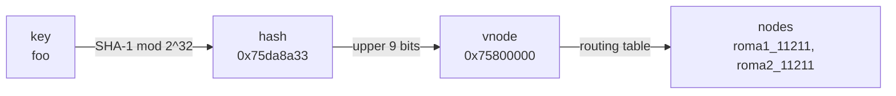
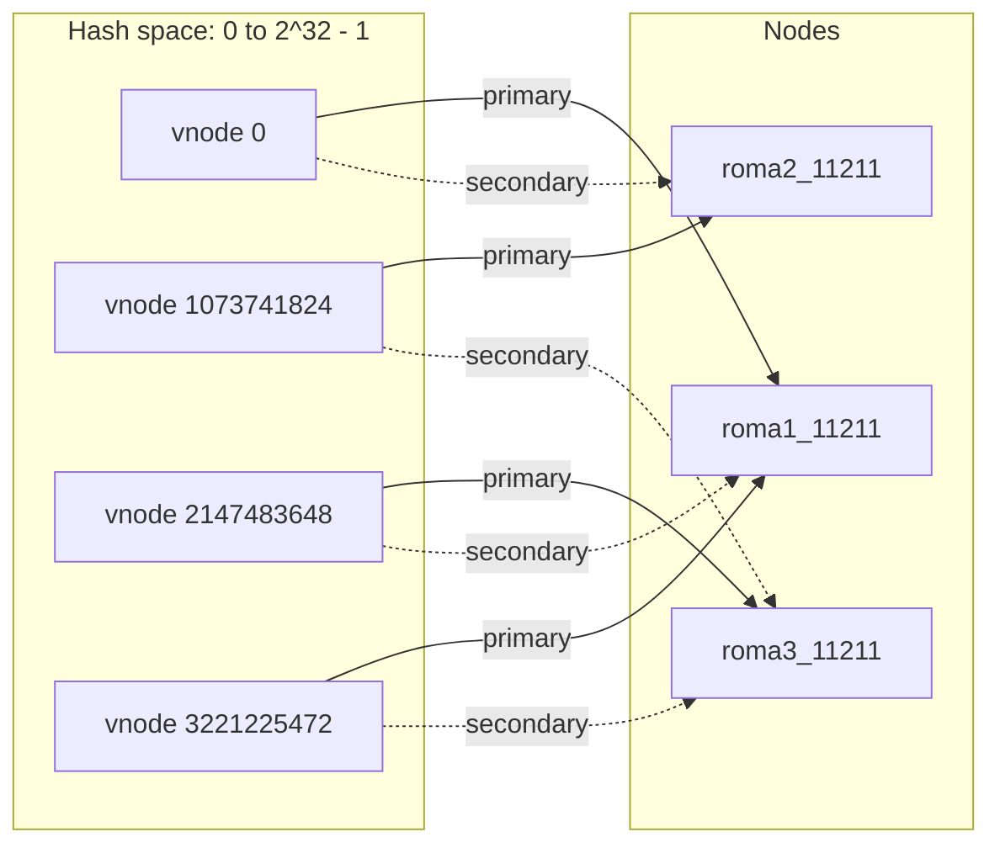
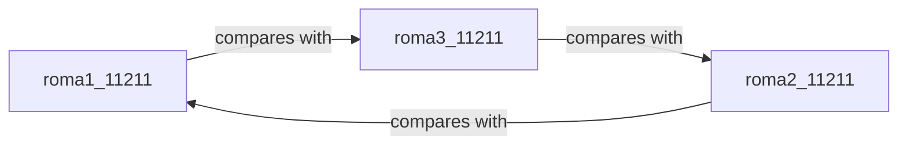
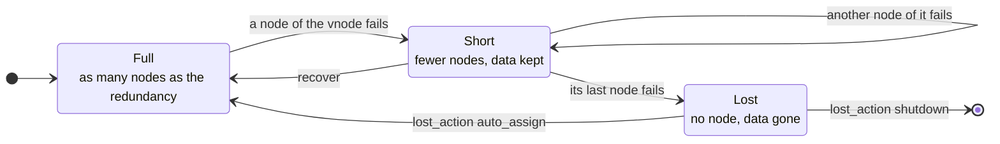
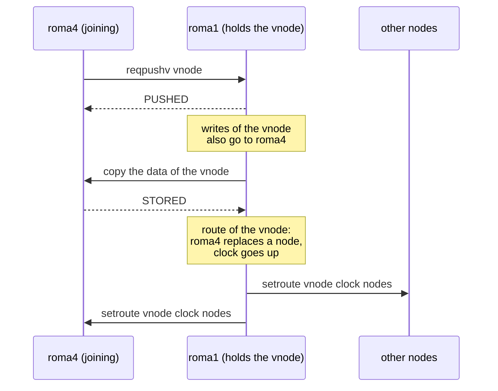

# Routing in ROMA

This document explains what routing is in ROMA, what a routing file defines,
how nodes use it, and how to set it up and change it with the `roma` command.

- [Concepts](#concepts)
- [The routing file](#the-routing-file)
- [How routing works](#how-routing-works)
- [Setting up routing with the roma command](#setting-up-routing-with-the-roma-command)
- [Settings](#settings)
- [Troubleshooting](#troubleshooting)

## Concepts

### What routing is

A ROMA cluster is a set of processes called **nodes**. Each node keeps only a
part of the data. To read or write a key, ROMA needs to know which nodes hold
that key. **Routing** is the answer to that question, and the **routing table**
is the data that gives it.

ROMA has no master node. Every node has its own copy of the routing table, and
the nodes keep the copies the same by talking to each other. Any node can take
any request: if the key is not its own, it forwards the request to a node that
holds it.

### Node ID

A node is named by its address and port joined with an underscore, such as
`localhost_11211` or `roma1.example.com_11211`. This is the **node ID**. The
`roma` command also takes `host:port` and turns it into `host_port`.

The address in the node ID is the one other nodes and clients connect to, so it
must be the same address that you give to `roma server`.

### Virtual nodes

ROMA does not map each key to a node directly. It splits the space of key
hashes into a fixed number of ranges called **virtual nodes** (vnodes), and
maps each vnode to nodes:



The number of vnodes never changes while the cluster runs. When nodes join or
leave, ROMA moves whole vnodes between nodes instead of rehashing keys. With
many more vnodes than nodes, each node gets about the same share of the data.

Two numbers decide the vnodes:

- **Digest bits** (`digest_bits`, default 32): a key's hash is the SHA-1 digest
  of the key modulo 2^digest_bits.
- **Divide bits** (`divide_bits`, default 9): the upper divide_bits bits of the hash
  are the vnode. There are 2^divide_bits vnodes, 512 by default.

The ID of a vnode is the first hash value in its range. With the defaults, the
vnodes are 0, 8388608 (2^23), 16777216 (2^24), and so on.

### Redundancy, primary and secondaries

Each vnode is held by several nodes so that data survives a node failure. The
number of nodes that hold each vnode is the **redundancy** (default 2).

The nodes of a vnode are in order. The first is the **primary**: it takes the
writes of the vnode and copies them to the others. The rest are the
**secondaries** (secondary1, secondary2, ...).

By default, ROMA puts the nodes of a vnode on different hosts, so that one
machine going down does not take every copy of a vnode. A host is the part of
the node ID before the underscore. **Replication in host** permits two nodes on
the same host to hold the same vnode. You need it to run more than one node on
a single machine, such as on a development machine.

### What the routing table holds

So, the routing table is:

- the digest bits, the divide bits and the redundancy,
- the list of nodes in the cluster,
- for each vnode, the ordered list of its nodes (primary first), and
- for each vnode, a **clock**: a number that goes up every time the nodes of
  the vnode change. The nodes use it to tell a newer route from an older one.

This is a routing table of 3 nodes on 3 hosts, with 4 vnodes (divide bits 2)
and redundancy 2. Each vnode covers a quarter of the hash space, and has a
primary and a secondary on different hosts:



## The routing file

The **routing file** is where a node keeps its routing table across restarts.
Each node has its own file, named `<node-id>.route`, in the directory of the
`routing.path` setting (the current directory by default). A node reads it when
it starts, so it must exist before the first start. `roma route create` makes it.

The file is the routing table in YAML. This is one made for two nodes with 8
vnodes (`-d 3`):

```yaml
--- !ruby/object:Roma::Routing::RoutingData
digest_bits: 32
divide_bits: 3
redundancy: 2
nodes:
- localhost_11211
- localhost_11212
routes:
  0:
  - localhost_11212
  - localhost_11211
  536870912:
  - localhost_11211
  - localhost_11212
  # ... 6 more vnodes
clocks:
  0: 0
  536870912: 0
  # ... 6 more vnodes
```

`routes` maps each vnode to its nodes, primary first, and `clocks` maps each
vnode to its clock.

### Routing logs

A running node does not rewrite the routing file. It appends each change of its
routing table to a **routing log** next to it: `<node-id>.route.1`,
`<node-id>.route.2`, and so on. A log goes on to the next number when it grows
over about 1 MB. Each line is a time and one change:

```
2026-11-02T00:33:55.233845 join localhost_11213
2026-11-02T00:33:55.256183 setroute 0 2 localhost_11213 localhost_11212
2026-11-02T00:35:11.621871 leave localhost_11213
```

- `join <node-id>`: a node joined the cluster.
- `leave <node-id>`: a node left the cluster.
- `setroute <vnode> <clock> <node-id>...`: the vnode now has these nodes and
  this clock.

When a node starts, it reads the routing file and then replays the logs in
order, so it starts with the routing table it had when it stopped.

```mermaid
flowchart LR
    file["roma1_11211.route<br>the table when the logs began"] --> replay
    log1["roma1_11211.route.1"] --> replay
    log2["roma1_11211.route.2"] --> replay
    replay(["read and replay in order"]) --> table["routing table<br>in memory"]
    table -->|"each change"| next["the last log, or a new one"]
``` Keep the
routing file and its logs together: the file alone is the table from when the
logs began.

`roma route snapshot NODE_ID` folds the logs, except the last one, into the routing
file. It keeps the old files with a trailing `~`. Run it when the logs become
many.

## How routing works

### Reads and writes

For each request, a node finds the vnode of the key and looks up its nodes in
the routing table:

- **Write** (set, delete, ...): the primary stores the data and then sends it
  to each secondary. If another node gets the request, it forwards it to the
  primary.
- **Read** (get, ...): any node of the vnode answers from its own storage. A
  node that does not hold the vnode forwards the request to the primary.

This is a write that a client sends to a node that does not hold the vnode of
the key:

```mermaid
sequenceDiagram
    participant C as Client
    participant X as roma3 (not of the vnode)
    participant P as roma1 (primary)
    participant S as roma2 (secondary)
    C->>X: set foo
    X->>P: forward set foo
    P->>P: store foo
    P->>S: copy foo
    S-->>P: STORED
    P-->>X: STORED
    X-->>C: STORED
```

If the copy to a secondary fails, the primary retries it later in the
background.

So clients can connect to any node. This is how memcached clients work with
ROMA. The ROMA client libraries fetch the routing table from a node instead and
send each request to the right node directly.

The `get_key_info` command tells where a key goes:

```
$ telnet localhost 11211
get_key_info foo
d = 1977256499 0x75da8a33
vn = 1610612736 0x60000000
nodes = ["localhost_11211", "localhost_11212"]
END
```

`d` is the hash of the key, `vn` is its vnode, and `nodes` are the nodes of the
vnode, primary first.

### Starting the cluster

A node starts with the routing table from its routing file. It does not take
any node as failed until every node in the table answers. Until then, it logs
"I'm waiting for booting the ... instance." Start every node of the cluster
before using it.

### Keeping the routing tables the same

Each node changes its own routing table and tells the others. A node can miss a
change, for example while it was busy. So every 10 seconds each node compares
its routing table with the one of the node before it in the node list. The
first node compares with the last, so the comparisons go around the cluster:



To compare without sending the whole table, the nodes keep a Merkle tree of
hashes over the vnodes. They compare the root, then the halves that differ, and
so on down to the vnodes that differ. For each of those vnodes, the route with
the newer clock wins, and the node with the older one takes it.

### When a node fails

Every second, each node checks the other nodes. A node that fails to answer
`routing.failure_count_threshold` times in a row (15 by default) is taken as
**failed**. The nodes then remove it from the routing table, which is logged
as `leave <node-id>`, and tell each other.

Removing a node from a vnode leaves the vnode with fewer nodes than the
redundancy. Such vnodes are **short**. The data is still there, but with fewer
copies. `roma node command recover` copies the short vnodes to other nodes until each
has the full redundancy again. With `routing.auto_recover`, ROMA does it by
itself.

If a vnode loses all its nodes, its data is **lost**. `routing.lost_action`
decides what happens then:

- `:auto_assign` (default): the vnode gets the nodes of the next vnode that has
  any, so the keys of the vnode can be written again. The old data is gone
  unless you put it back by `roma storage recover-lost`.
- `:shutdown`: every node stops, so that no one reads a wrong empty value.
- `:no_action`: the vnode stays without nodes, and requests for its keys fail.

A vnode goes through these states:



With `:auto_assign`, the vnode takes over the nodes of the next vnode, and is
full or short like that one.

### When nodes join and leave

The number of nodes changes while the cluster runs. ROMA moves vnodes one by
one, and for each vnode it copies the data first and changes the route after:

- **Join**: a new node starts with `--join` and the address of a running node.
  It gets the routing table from that node, joins the node list, and takes
  vnodes until it has its share: short vnodes first, then vnodes on other
  hosts.
- **Balance**: a node with fewer primaries than its share takes vnodes from the
  others.
- **Release**: a node gives each of its vnodes to other nodes. When it holds no
  vnode, you can stop it without making any vnode short.

This is how a joining node takes one vnode from a node that holds it. While the
data is copied, writes to the vnode also go to the joining node, so that it
misses none:



## Setting up routing with the roma command

### Make the routing files

`roma route create` takes the node IDs of the cluster and writes a routing file for
each, `<node-id>.route`, into the current directory:

```
$ roma route create roma1_11211 roma2_11211 roma3_11211
nodes => ["roma1_11211", "roma2_11211", "roma3_11211"]
Routing table has created.
```

It assigns nodes to each vnode at random, then tries to make each node the
primary and each secondary of the same number of vnodes. The share is near
even, but not always exact. Every file holds the same table.

| Option | Default | Meaning |
| --- | --- | --- |
| `--digest-bits BITS` | 32 | Digest bits |
| `-d`, `--divide-bits BITS` | 9 | Divide bits: there are 2^BITS vnodes |
| `-r`, `--redundancy NUM` | 2 | Redundancy: nodes that hold each vnode |
| `--replication-in-host` | off | Permit a host to hold the same vnode twice |

How to choose them:

- **Divide bits** fix the number of vnodes for the life of the cluster. Choose
  enough for the largest cluster that you expect: several vnodes per node at
  least, and many more for an even share. The default, 512 vnodes, is fine for
  tens of nodes. Each vnode is also the unit that is copied at once when nodes
  join or leave, so more vnodes mean smaller moves.
- **Redundancy** is how many node failures a vnode survives (redundancy − 1).
  It must not be more than the number of nodes, and without
  `--replication-in-host`, not more than the number of hosts.
- **Digest bits**: keep the default. They must be the divide bits or more.
- **`--replication-in-host`**: use it only when several nodes of the cluster are
  on one host. Without it, `roma route create` does not put two nodes of a host in the
  same vnode, so a cluster on one host gets vnodes with **one node only** and
  no redundancy, without any error.

Copy each file to the `routing.path` directory of its node.

### Start the nodes

Start each node with the address and port of its node ID:

```
roma1$ roma server roma1 -p 11211 -d --config config.rb
roma2$ roma server roma2 -p 11211 -d --config config.rb
roma3$ roma server roma3 -p 11211 -d --config config.rb
```

If the routing was made with `--replication-in-host`, give it to `roma server`
of every node too. The nodes use it to choose where to move vnodes when nodes
join, leave or recover.

For a try on one machine:

```
$ roma route create localhost_11211 localhost_11212 --replication-in-host
$ roma server localhost -p 11211 -d --replication-in-host
$ roma server localhost -p 11212 -d --replication-in-host
```

### Look at the routing table

`stats routing` on any node shows its routing table:

```
$ roma node command -p 11211 "stats routing"
routing.redundant 2
routing.nodes.length 2
routing.nodes ["localhost_11211", "localhost_11212"]
routing.digest_bits 32
routing.divide_bits 9
routing.vnodes.length 512
routing.primary 270
routing.secondary1 242
routing.short_vnodes 0
routing.lost_vnodes 0
...
```

- `routing.primary` and `routing.secondaryN`: the vnodes for which this node is
  the primary or that secondary.
- `routing.short_vnodes`: vnodes with fewer nodes than the redundancy. Run
  `recover` when it is not 0.
- `routing.lost_vnodes`: vnodes without any node.
- `routing.event`: the recent joins and leaves.

Other commands:

- `roma node command -p 11211 nodelist` lists the nodes.
- `roma cluster check roma1_11211 roma2_11211 roma3_11211` checks that the nodes
  answer and have the same nodes, and exits with 1 otherwise.
- `roma node command -p 11211 "routingdump yaml"` prints the routing table in the format
  of the routing file.

### Add a node

Start the new node with `--join` and any running node. It needs no routing file
of its own: it gets the routing table from that node and writes its own routing
file.

```
roma4$ roma server roma4 -p 11211 -d --config config.rb --join roma1:11211
```

The new node must have the same `name` setting as the cluster. It then takes
vnodes until it has its share. Watch `routing.primary` of the new node go up.

To even out the nodes after that, run `balance` on any node. Every node with
fewer primaries than its share takes vnodes, and the others answer that they
are not unbalanced:

```
$ roma node command -p 11211 balance
{"localhost_11212" => "STARTED", "localhost_11211" => "SERVER_ERROR Not unbalance or othre process is already running."}
```

### Remove a node

Release the node first, so that its vnodes go to other nodes with their data:

```
$ roma node command --host roma4 -p 11211 release
STARTED
```

Wait until `stats routing` of that node shows `routing.primary 0` and
`routing.secondary1 0` (and so on). Then stop the process, for example by
`kill`. The other nodes take it as failed and remove it from the node list.

Release needs enough nodes left: at least the redundancy, and on that many
hosts without replication in host.

### Recover after a failure

When a node fails, check `routing.short_vnodes`, and copy the short vnodes to
the other nodes:

```
$ roma node command -p 11211 recover
{"localhost_11212" => "STARTED", "localhost_11211" => "STARTED"}
```

Recover needs at least as many nodes as the redundancy. To bring the failed
machine back, start its node with `--join`, as for a new node. Move its old
routing file and logs away first: they are of the time before it failed, and
the node would replay the old logs at its next restart.

If vnodes were lost, `roma node command -p 11211 history_of_lost` lists them, and
`roma storage recover-lost` pushes their data back from the storage files of the failed
node.

### Stop and restart the cluster

```
$ roma node command -p 11211 balse
```

stops every node. Each node keeps its routing file and logs, and starts with
the same routing table next time. Start every node again with the same address
and port.

### Change the redundancy

`roma route change-redundancy NUM NODE_ID` prints the routing table of a running node
with another redundancy, in the format of the routing file. A lower redundancy
drops the last nodes of each vnode, and every clock starts over from 0.

To use it, stop the cluster, put the printed table into the routing file of
every node, and move the routing logs away, since a node replays them over the
file when it starts. After a higher redundancy, the vnodes are short: run
`recover` to make the new copies.

## Settings

These settings in the config file are about routing. See
[lib/roma/configuration.rb](../lib/roma/configuration.rb) for all of them.

| Setting | Default | Meaning |
| --- | --- | --- |
| `config.routing.path` | `'.'` | Directory of the routing files and logs |
| `config.routing.failure_count_threshold` | `15` | Failed checks in a row before a node is taken as failed |
| `config.routing.failure_count_gap` | `0` | Seconds within which another failure does not count up |
| `config.routing.lost_action` | `:auto_assign` | What to do with lost vnodes: `:auto_assign`, `:shutdown` or `:no_action` |
| `config.routing.auto_recover` | `false` | Recover short vnodes by itself |
| `config.routing.node_id_substitutions` | `{}` | Host names to replace in the routing table that clients get, by client network |
| `config.routing.event_limit_line` | `1000` | Joins and leaves to keep in `routing.event` |

`node_id_substitutions` is for clients that reach the nodes by other addresses than the nodes
use among themselves. For example, this makes clients in 192.168.1.0/24 get
`192.168.1.11` where the routing table has `roma1`:

```ruby
config.routing.node_id_substitutions = { '192.168.1.0/24' => { regexp: 'roma1', replace: '192.168.1.11' } }
```

`roma node command -p 11211 add_rttable_sub_nid 192.168.1.0/24 roma1 192.168.1.11` adds
one to the running nodes.

## Troubleshooting

**`<path>/<node-id>.route not found.`** The node has no routing file. Make it by
`roma route create`, or start the node with `--join`. Check that the address and port
of `roma server` match the node ID, and that the file is in `routing.path`.

**The node keeps logging "I'm waiting for booting the ... instance."** A node in
the routing table is not running. Start it, or, if it is gone for good, check
that the node list is what you expect.

**`routing.short_vnodes` is not 0 right after `roma route create`.** The routing was made for
one host without `--replication-in-host`, or with a redundancy higher than the
number of hosts. Make it again.

**`ROMA has already contained <node-id>.`** on `--join`: the node is still in the
routing table of the cluster. Wait until the cluster removes it, or use another
port.

**`<node> has diffarent name.`** The node has another `name` setting than the
cluster. Every node of a cluster needs the same name.
